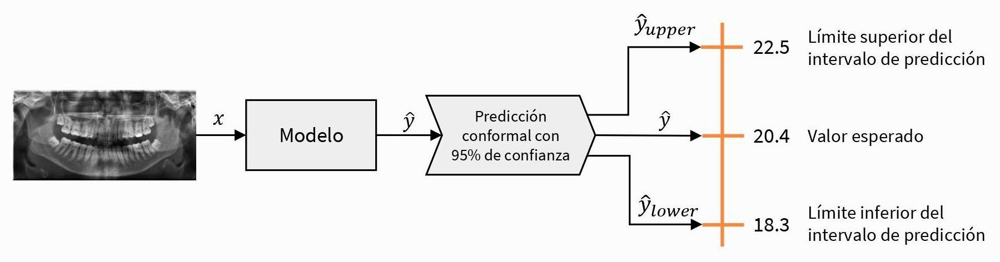
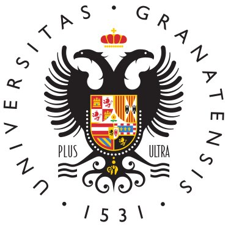
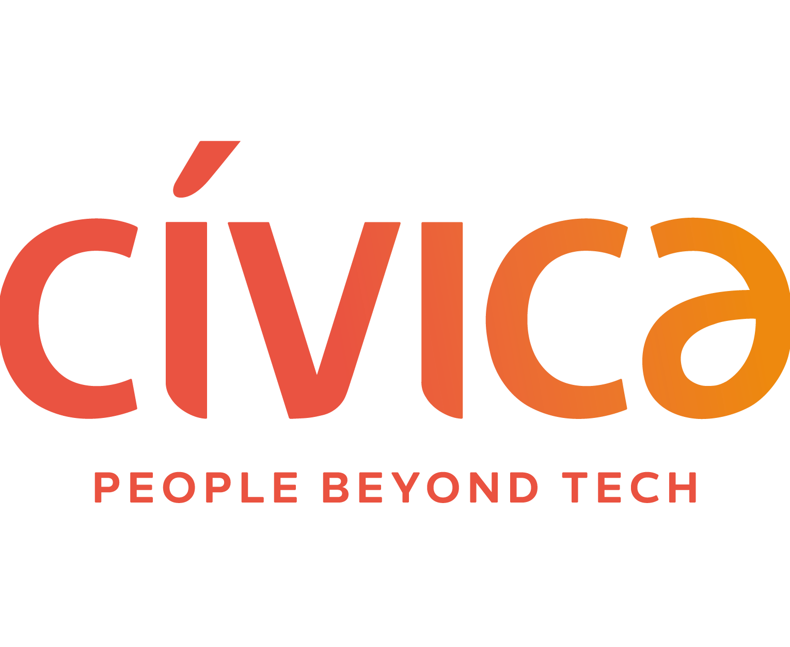

```python
print("Hello World!")
```

## []{.bi .bi-person-vcard} Bio

Hi! I'm David, a recent graduate in Computer Engineering and Business Administration from the University of Granada, specialising in **Data Science** and **Computer Vision**. I have hands-on experience across the data lifecycle from my internship as a **Junior Data Engineer** at Cívica Software. I'm interested in **Trustworthy AI**, particularly uncertainty quantification and interpretability, fields I keep studying to help make intelligent systems transparent, robust and ethical.

I'm currently looking for a job! 😉

::: {.callout-note .tarjeta collapse="true" appearance="minimal"}
### []{.bi .bi-book .icono} [My full story]{.titulo} [Click to read it]{.subtitulo}

During my university studies I discovered my passion for AI, specifically _Machine Learning_, which made it possible to build algorithms that went far beyond code and to extract complex patterns from raw data, turning them into deep knowledge. This passion led me naturally to **Data Science**. I enjoy digging into datasets to uncover hidden patterns and creating visualisations that help explain the reality behind them.

My technical foundation in the data lifecycle was strengthened during my extracurricular internship at [Cívica Software](https://civica-soft.com/), where I worked for 3 months as a **Junior Data Engineer** on a project for a financial institution. There I gained essential experience in the database ecosystem, which helped me understand the data lifecycle and ETL processes.

Later, thanks to one of the most demanding but rewarding courses of my degree, I developed a strong interest in **Computer Vision**. This field allowed me to explore classical image representation and filtering, hand-crafted feature extraction and, ultimately, to dive into the fascinating world of _Deep Learning_, exploring the potential of CNNs and _Transformers_ in complex tasks such as object detection and segmentation.


However, I also realised that AI is not infallible: it not only makes objective mistakes, but also reproduces inaccuracies and systemic biases inherited from human-collected datasets. As a result, I have moved increasingly towards **Trustworthy AI**. I believe that for artificial intelligence to be truly useful in the real world, it must be transparent and robust.

My most recent focus in this area is **Uncertainty Quantification**, the core of my Bachelor's Thesis: _Uncertainty quantification in the predictions of machine learning models for biological profile estimation problems_ (more details below in [Projects](#sec-projects)). This work integrates **Conformal Prediction** into biological estimation tasks, such as estimating age and sex from maxillofacial X-rays, providing prediction intervals (in regression) and label sets (in classification) with statistical guarantees, thus capturing the uncertainty in each case.



I'm currently reading _Interpretable Machine Learning_ by Christoph Molnar, to get a fuller picture of how to open the "black box" of algorithms.

Beyond academics, I have always believed in taking an active part in the university community. During my degree I had the honour of serving for 1 year as **vice-secretary** and for 2 years as **secretary of the Student Delegation of Computer and Telecommunication Engineering** (DEIIT). In this role I was responsible for calling plenary sessions, drafting and publishing the minutes and managing the member register, as well as helping to organise school events (Fine Arts markets, School Day and a video game development Hackathon) or collaborating in others (Granabot).
:::

## []{.bi .bi-mortarboard} Education

::: {.callout-note .tarjeta collapse="true" appearance="minimal"}
### {.icono} [Double Degree in Computer Engineering and Business Administration]{.titulo} [University of Granada · 2019/2020 – 2025/2026 (6 years)]{.subtitulo}

Average grade of 8.01/10 in Computer Engineering and 8.36/10 in Business Administration.
:::

## []{.bi .bi-briefcase} Work experience

::: {.callout-note .tarjeta collapse="true" appearance="minimal"}
### {.icono} [Extracurricular internship: Junior Data Engineer]{.titulo} [Cívica Software · July to October 2024 (3 months)]{.subtitulo}

- Maintenance of Teradata and Snowflake databases.
- Monitoring of data flows through ETL processes with Informatica PowerCenter.
- Writing and maintaining the projects' technical documentation, ensuring clarity and traceability of processes, with Microsoft Word.
- Preparing statistical reports to track KPIs with Power BI.

[Cívica Software website](https://civica-soft.com/)
:::

## []{.bi .bi-journal-code} Projects {#sec-projects}

::: {.callout-note .tarjeta collapse="true" appearance="minimal"}
### []{.bi .bi-mortarboard-fill .icono} [Uncertainty quantification in the predictions of machine learning models for biological profile estimation problems]{.titulo} [Bachelor's Thesis]{.subtitulo}


In collaboration with [Panacea Cooperative Research](https://panacea-coop.com/), supervised by [Pablo Mesejo Santiago](https://www.ugr.es/~pmesejo/) and mentored by [Javier Venema Rodríguez](https://www.linkedin.com/in/javier-venema/).

- Finding and managing academic literature (over 100 references, including books, papers and websites).
- Analysis, synthesis and application of state-of-the-art methods for biological estimation problems.
- Collaborative tools: Overleaf, Google Workspace and Microsoft 365.

[[]{.bi .bi-github} tfg-bioprofile-uncertainty](https://github.com/esdavide2910/tfg-bioprofile-uncertainty){.btn .btn-dark}
:::

## []{.bi .bi-laptop} IT skills

::: {.callout-note .tarjeta collapse="true" appearance="minimal"}
### []{.bi .bi-graph-up .icono} [Data Science]{.titulo} [Overall level: advanced]{.subtitulo}

- Advanced use of **Pandas** and **Polars** for high-performance data manipulation and cleaning.
- **Matplotlib**, **Seaborn** and **Plotly** to communicate complex insights through interactive, publication-quality charts.
- Expert use of **Scikit-Learn** for classical machine learning, and **PyTorch** and **TensorFlow/Keras** for deep learning.
- Specialised in uncertainty quantification with **Crepes**, **MAPIE** and **TorchCP**.
:::

::: {.callout-note .tarjeta collapse="true" appearance="minimal"}
### []{.bi .bi-eye .icono} [Computer Vision]{.titulo} [Overall level: advanced]{.subtitulo}

Experience in advanced academic projects with tools such as:

- **OpenCV** for advanced image manipulation, digital filtering and classical vision.
- **Pillow** for efficient image format handling and data preprocessing.
- Advanced use of **PyTorch** and **TensorFlow/Keras** to implement deep networks.
- Familiarity with **ONNX** for model interoperability.
:::

::: {.callout-note .tarjeta collapse="true" appearance="minimal"}
### []{.bi .bi-database .icono} [Data Engineering and Analytics]{.titulo} [Overall level: intermediate]{.subtitulo}

Intermediate **SQL** (CTEs, window functions, procedures…). Hands-on experience in corporate environments, focused on monitoring and maintaining existing data structures:

- **Data Warehousing**: intermediate experience with **Snowflake** and **Teradata**, monitoring analytical datasets and making minor schema changes.
- **ETL & Integration**: basic experience with **Informatica PowerCenter**.
- Intermediate knowledge of **Power BI** for data visualisation.
:::

::: {.callout-note .tarjeta collapse="true" appearance="minimal"}
### []{.bi .bi-file-earmark-text .icono} [Technical communication]{.titulo} [Overall level: advanced]{.subtitulo}

Clarity, structure and reproducibility in documents are cornerstones of communication.

- Advanced use of **LaTeX** and **Typst** to typeset high-quality scientific documents and reports.
- Building websites with **Quarto** (like this one 😄).
- **Collaborative tools**: Overleaf, Google Workspace and Microsoft 365.
:::

::: {.callout-note .tarjeta collapse="true" appearance="minimal"}
### []{.bi .bi-git .icono} [Software Engineering]{.titulo} [Overall level: basic]{.subtitulo}

- **Version control**: regular use of **Git** and **GitHub** for collaborative development and code versioning.
- **Containers**: basic experience with **Docker** to isolate personal environments.
:::

::: {.callout-note .tarjeta collapse="true" appearance="minimal"}
### []{.bi .bi-code-slash .icono} [Programming languages and HDL]{.titulo}

- **Python**: advanced proficiency in building data analysis and visualisation applications and deploying Machine Learning models. Solid experience with the scientific ecosystem (Pandas, NumPy, Matplotlib/Seaborn) and with building efficient data processing workflows.
- **C++** and **Java**: intermediate level, used during my degree for small and medium-sized projects (object-oriented programming).
- **Verilog (Intel Altera)**: basic level.
- **R**: basic level for data visualisation. Learning it right now!
:::

## []{.bi .bi-people} Soft skills

::: {.callout-note .tarjeta collapse="true" appearance="minimal"}
### []{.bi .bi-kanban .icono} [Organisational role]{.titulo}

During my degree, both in team projects and as secretary of the DEIIT, I have been strongly inclined to organise, plan and standardise work, and to communicate clearly and assertively with other members to make sure goals were met on time.
:::

::: {.callout-note .tarjeta collapse="true" appearance="minimal"}
### []{.bi .bi-arrow-up-circle .icono} [Continuous improvement]{.titulo}

I see myself as a curious person with a lifelong-learning mindset and a strong ability to adopt new technologies, methodologies and tools that improve the quality of my daily work.
:::

::: {.callout-note .tarjeta collapse="true" appearance="minimal"}
### []{.bi .bi-shield-lock .icono} [Good digital security practices]{.titulo}

Committed to a culture of information security. I proactively manage my digital security with password managers, encryption and protection of confidential data to ensure integrity and privacy in every project.
:::

## []{.bi .bi-bookmark-heart} Interests

::: {.callout-note .tarjeta collapse="true" appearance="minimal"}
### []{.bi .bi-bar-chart .icono} [DataViz]{.titulo}

Focused on exploratory data analysis (EDA) and on designing visualisations that help us understand data.
:::

::: {.callout-note .tarjeta collapse="true" appearance="minimal"}
### []{.bi .bi-shield-check .icono} [Trustworthy AI]{.titulo}

Interested in uncertainty quantification and explainable AI to build reliable systems, especially in settings where reliability and risk quantification are essential.
:::

## []{.bi .bi-translate} Languages

::: {.callout-note .tarjeta appearance="minimal"}
### []{.bi .bi-chat-text .icono} [Spanish]{.titulo} [Native]{.subtitulo}
:::

::: {.callout-note .tarjeta collapse="true" appearance="minimal"}
### []{.bi .bi-chat-text .icono} [English]{.titulo} [Upper intermediate (B2)]{.subtitulo}

Cambridge FCE certificate. Verification number: D5753484.
:::

## []{.bi .bi-person-check} References

::: {.callout-note .tarjeta collapse="true" appearance="minimal"}
### []{.bi .bi-person-badge .icono} [Pablo Mesejo Santiago]{.titulo} [University of Granada · Panacea Cooperative Research]{.subtitulo}

[Pablo Mesejo Santiago](https://www.ugr.es/~pmesejo/) is an Associate Professor in the Department of Computer Science and Artificial Intelligence at the University of Granada, and co-founder and Director of Artificial Intelligence at Panacea Cooperative Research.

[[]{.bi .bi-file-earmark-pdf} Download recommendation letter](../assets/documents/recommendation-letter.pdf){.btn .btn-outline-primary target="_blank"}
:::
