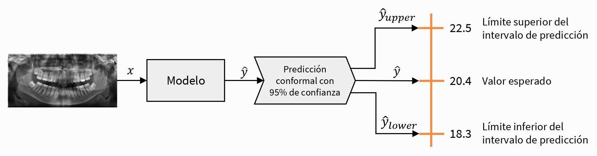
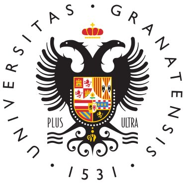
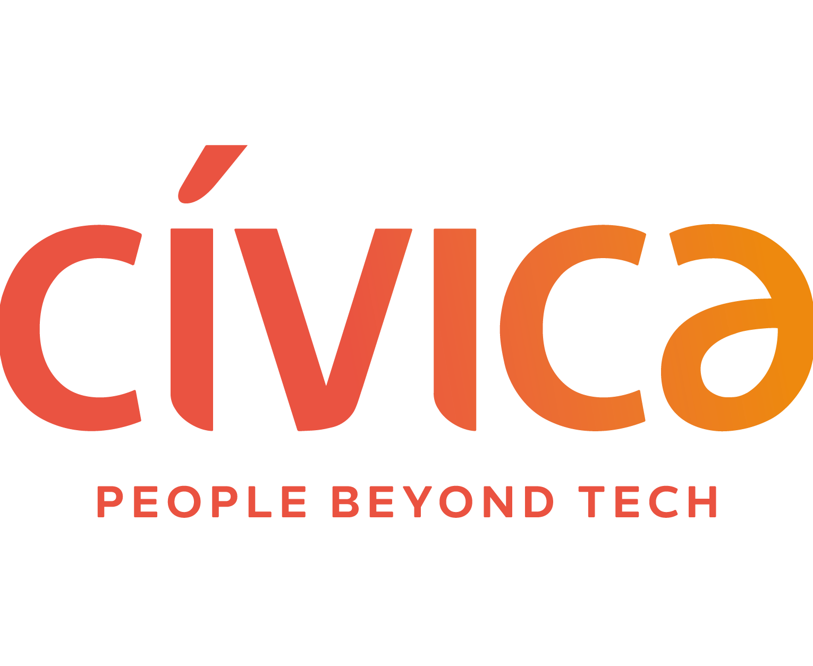

```python
print("Hola Mundo!")
```

## []{.bi .bi-person-vcard} Bio

¡Hola! Soy David, recién graduado por la Universidad de Granada en Ingeniería Informática y Administración y Dirección de Empresas, especializado en **Data Science** y **Computer Vision**. Tengo experiencia práctica en el ciclo de vida del dato gracias a mis prácticas como **Junior Data Engineer** en Cívica Software. Me interesa la **IA confiable** (_Trustworthy AI_), en concreto la cuantificación de la incertidumbre y la interpretabilidad, campos en los que sigo profundizando para garantizar que los sistemas inteligentes sean transparentes, robustos y éticos.

¡Actualmente estoy buscando trabajo! 😉

::: {.callout-note .tarjeta collapse="true" appearance="minimal"}
### []{.bi .bi-book .icono} [Mi trayectoria completa]{.titulo} [Haz clic para leerla]{.subtitulo}

Durante mi carrera universitaria descubrí mi pasión por la IA, concretamente por el _Machine Learning_, que permitía obtener algoritmos que iban mucho más allá del código y extraer patrones complejos a partir de datos en bruto para transformarlos en conocimiento profundo. Esta pasión me llevó de forma natural hacia la **Ciencia de Datos**. Disfruto profundizando en conjuntos de datos para descubrir patrones ocultos y creando visualizaciones que ayuden a comprender la realidad que subyace a ellos.

Mi base técnica en el ciclo de vida del dato se consolidó durante mis prácticas extracurriculares en [Cívica Software](https://civica-soft.com/), donde trabajé 3 meses como **Junior Data Engineer** en un proyecto para una entidad financiera. Allí adquirí una experiencia fundamental en el ecosistema de bases de datos, lo que me permitió comprender el ciclo de vida del dato y los procesos ETL.

Más tarde, gracias a una de las asignaturas más exigentes pero agradecidas de la carrera, desarrollé un fuerte interés por la **Visión por Computador**. Este campo me permitió explorar la representación y el filtrado clásicos de imágenes, la extracción de características artesanales y, en última instancia, sumergirme en el fascinante mundo del _Deep Learning_, explorando el potencial de las CNNs y los _Transformers_ en tareas complejas como la detección de objetos y la segmentación.


Sin embargo, también comprobé que la IA no es infalible: no solo comete errores objetivos, sino que reproduce imprecisiones y sesgos sistémicos derivados de los conjuntos de datos recopilados por humanos. Por eso me he acercado cada vez más al campo de la **IA Confiable (_Trustworthy AI_)**. Creo que, para que la inteligencia artificial sea realmente útil en el mundo real, debe ser transparente y robusta.

Mi enfoque más reciente en este sentido es la **Cuantificación de la Incertidumbre**, el núcleo de mi Trabajo de Fin de Grado: _Cuantificación de la incertidumbre en las predicciones de modelos de machine learning para problemas de estimación del perfil biológico_ (más detalles abajo, en [Proyectos](#sec-proyectos)). Este trabajo integra **Conformal Prediction** en tareas de estimación biológica, como la estimación de la edad y el sexo a partir de radiografías maxilofaciales, proporcionando intervalos de predicción (en regresión) y conjuntos de etiquetas (en clasificación) con garantías estadísticas, capturando así la incertidumbre en cada caso.



Actualmente estoy leyendo _Interpretable Machine Learning_, de Christoph Molnar, para tener una visión más completa de cómo abrir la «caja negra» de los algoritmos.

Más allá de lo académico, siempre he creído en la importancia de participar activamente en la comunidad universitaria. Durante el grado tuve el honor de ser durante 1 año **vicesecretario** y durante 2 años **secretario de la Delegación de Estudiantes de Ingenierías Informática y de Telecomunicaciones** (DEIIT). En esta etapa me encargué de convocar las sesiones plenarias, redactar y publicar las actas y gestionar el censo de miembros, además de ayudar a organizar eventos en la escuela (mercadillos de BBAA, Día de la Escuela y Hackathon de desarrollo de videojuegos) o colaborar en otros (Granabot).
:::

## []{.bi .bi-mortarboard} Formación académica

::: {.callout-note .tarjeta collapse="true" appearance="minimal"}
### {.icono} [Doble Grado en Ingeniería Informática y Administración y Dirección de Empresas]{.titulo} [Universidad de Granada · Curso 2019/2020 – 2025/2026 (6 años)]{.subtitulo}

Nota media de 8,01 en Ingeniería Informática y 8,36 en Administración y Dirección de Empresas.
:::

## []{.bi .bi-briefcase} Experiencia laboral

::: {.callout-note .tarjeta collapse="true" appearance="minimal"}
### {.icono} [Prácticas extracurriculares: Junior Data Engineer]{.titulo} [Cívica Software · Julio a octubre de 2024 (3 meses)]{.subtitulo}

- Mantenimiento de bases de datos en Teradata y Snowflake.
- Supervisión de flujos de datos mediante procesos ETL con Informatica PowerCenter.
- Redacción y mantenimiento de la documentación técnica de los proyectos, garantizando la claridad y la trazabilidad de los procesos con Microsoft Word.
- Elaboración de informes estadísticos para el seguimiento de los KPI con Power BI.

[Web de Cívica Software](https://civica-soft.com/)
:::

## []{.bi .bi-journal-code} Proyectos {#sec-proyectos}

::: {.callout-note .tarjeta collapse="true" appearance="minimal"}
### []{.bi .bi-mortarboard-fill .icono} [Cuantificación de la incertidumbre de las predicciones de modelos de aprendizaje automático en problemas de estimación del perfil biológico]{.titulo} [Trabajo de Fin de Grado]{.subtitulo}


En colaboración con [Panacea Cooperative Research](https://panacea-coop.com/), dirigido por [Pablo Mesejo Santiago](https://www.ugr.es/~pmesejo/) y mentorizado por [Javier Venema Rodríguez](https://www.linkedin.com/in/javier-venema/).

- Acceso y gestión de información académica (más de 100 referencias, entre libros, artículos y sitios web).
- Análisis, síntesis y aplicación de métodos del estado del arte para problemas de estimación biológica.
- Ecosistemas colaborativos: Overleaf, Google Workspace y Microsoft 365.

[[]{.bi .bi-github} tfg-bioprofile-uncertainty](https://github.com/esdavide2910/tfg-bioprofile-uncertainty){.btn .btn-dark}
:::

## []{.bi .bi-laptop} Habilidades IT

::: {.callout-note .tarjeta collapse="true" appearance="minimal"}
### []{.bi .bi-graph-up .icono} [Data Science]{.titulo} [Nivel general avanzado]{.subtitulo}

- Uso avanzado de **Pandas** y **Polars** para la manipulación y limpieza de datos de alto rendimiento.
- **Matplotlib**, **Seaborn** y **Plotly** para comunicar conocimientos complejos mediante gráficos interactivos y con calidad de publicación.
- Uso experto de **Scikit-Learn** para el aprendizaje automático clásico, y de **PyTorch** y **TensorFlow/Keras** para el aprendizaje profundo.
- Especializado en la cuantificación de la incertidumbre con **Crepes**, **MAPIE** y **TorchCP**.
:::

::: {.callout-note .tarjeta collapse="true" appearance="minimal"}
### []{.bi .bi-eye .icono} [Visión artificial]{.titulo} [Nivel general avanzado]{.subtitulo}

Experiencia en proyectos académicos avanzados con herramientas como:

- **OpenCV** para la manipulación avanzada de imágenes, el filtrado digital y la visión clásica.
- **Pillow** para la gestión eficiente de formatos de imagen y el preprocesamiento de datos.
- Uso avanzado de **PyTorch** y **TensorFlow/Keras** para la implementación de redes profundas.
- Familiaridad con **ONNX** para la interoperabilidad de modelos.
:::

::: {.callout-note .tarjeta collapse="true" appearance="minimal"}
### []{.bi .bi-database .icono} [Ingeniería y análisis de datos]{.titulo} [Nivel general intermedio]{.subtitulo}

Nivel intermedio en **SQL** (CTEs, funciones de ventana, procedimientos…). Experiencia práctica en entornos empresariales centrada en la supervisión y el mantenimiento de estructuras de datos existentes:

- **Data Warehousing**: experiencia intermedia con **Snowflake** y **Teradata**, supervisando conjuntos de datos analíticos y realizando modificaciones menores en los esquemas.
- **ETL e integración**: experiencia básica con **Informatica PowerCenter**.
- Conocimientos intermedios de **Power BI** para la visualización de datos.
:::

::: {.callout-note .tarjeta collapse="true" appearance="minimal"}
### []{.bi .bi-file-earmark-text .icono} [Comunicación técnica]{.titulo} [Nivel general avanzado]{.subtitulo}

La claridad, el orden y la reproducibilidad de los documentos son pilares fundamentales de la comunicación.

- Uso avanzado de **LaTeX** y **Typst** para la composición de documentos e informes científicos de alta calidad.
- Creación de sitios web con **Quarto** (como esta página web 😄).
- **Ecosistemas colaborativos**: Overleaf, Google Workspace y Microsoft 365.
:::

::: {.callout-note .tarjeta collapse="true" appearance="minimal"}
### []{.bi .bi-git .icono} [Ingeniería del software]{.titulo} [Nivel general básico]{.subtitulo}

- **Control de versiones**: uso frecuente de **Git** y **GitHub** para el desarrollo colaborativo y el control de versiones del código.
- **Contenedores**: experiencia básica con **Docker** para aislar entornos de uso personal.
:::

::: {.callout-note .tarjeta collapse="true" appearance="minimal"}
### []{.bi .bi-code-slash .icono} [Lenguajes de programación y HDL]{.titulo}

- **Python**: dominio avanzado en el desarrollo de aplicaciones de análisis de datos, visualización y despliegue de modelos de Machine Learning. Experiencia sólida en el ecosistema científico (Pandas, NumPy, Matplotlib/Seaborn) y en el desarrollo de flujos de trabajo eficientes para el procesamiento de información.
- **C++** y **Java**: nivel intermedio, usados durante la carrera en proyectos pequeños y medianos (programación orientada a objetos).
- **Verilog (Intel Altera)**: nivel básico.
- **R**: nivel básico para generar visualizaciones de datos. ¡Aprendiendo ahora mismo!
:::

## []{.bi .bi-people} Competencias transversales

::: {.callout-note .tarjeta collapse="true" appearance="minimal"}
### []{.bi .bi-kanban .icono} [Rol organizativo]{.titulo}

Durante la carrera, tanto en los trabajos en equipo como en mi labor como secretario de la DEIIT, he tenido una fuerte inclinación por ordenar, planificar y homogeneizar el trabajo, así como por comunicarme de manera clara y asertiva con los demás miembros para asegurar que se cumplieran los objetivos en los plazos establecidos.
:::

::: {.callout-note .tarjeta collapse="true" appearance="minimal"}
### []{.bi .bi-arrow-up-circle .icono} [Mejora continua]{.titulo}

Me defino como una persona curiosa, con una mentalidad de aprendizaje constante y una gran capacidad para adoptar nuevas tecnologías, metodologías y herramientas que mejoren la calidad de mi trabajo diario.
:::

::: {.callout-note .tarjeta collapse="true" appearance="minimal"}
### []{.bi .bi-shield-lock .icono} [Buenas prácticas de seguridad digital]{.titulo}

Comprometido con la cultura de la seguridad de la información. Gestiono de forma proactiva mi seguridad digital mediante gestores de contraseñas, cifrado y protección de datos confidenciales para garantizar la integridad y la privacidad en cada proyecto.
:::

## []{.bi .bi-bookmark-heart} Intereses

::: {.callout-note .tarjeta collapse="true" appearance="minimal"}
### []{.bi .bi-bar-chart .icono} [DataViz]{.titulo}

Centrado en el análisis exploratorio de datos (EDA) y en el diseño de visualizaciones que nos ayuden a comprender los datos.
:::

::: {.callout-note .tarjeta collapse="true" appearance="minimal"}
### []{.bi .bi-shield-check .icono} [Trustworthy AI]{.titulo}

Interesado en la cuantificación de la incertidumbre y la IA explicable para crear sistemas fiables, sobre todo en entornos donde la fiabilidad y la cuantificación del riesgo son fundamentales.
:::

## []{.bi .bi-translate} Idiomas

::: {.callout-note .tarjeta appearance="minimal"}
### []{.bi .bi-chat-text .icono} [Español]{.titulo} [Nativo]{.subtitulo}
:::

::: {.callout-note .tarjeta collapse="true" appearance="minimal"}
### []{.bi .bi-chat-text .icono} [Inglés]{.titulo} [Nivel intermedio alto (B2)]{.subtitulo}

Certificación FCE de Cambridge. Número de verificación: D5753484.
:::

## []{.bi .bi-person-check} Recomendaciones

::: {.callout-note .tarjeta collapse="true" appearance="minimal"}
### []{.bi .bi-person-badge .icono} [Pablo Mesejo Santiago]{.titulo} [Universidad de Granada · Panacea Cooperative Research]{.subtitulo}

[Pablo Mesejo Santiago](https://www.ugr.es/~pmesejo/) es profesor asociado del Departamento de Informática e Inteligencia Artificial de la Universidad de Granada, y socio cofundador y director de Inteligencia Artificial de Panacea Cooperative Research.

[[]{.bi .bi-file-earmark-pdf} Descargar carta de recomendación](assets/documents/recommendation-letter.pdf){.btn .btn-outline-primary target="_blank"}
:::
